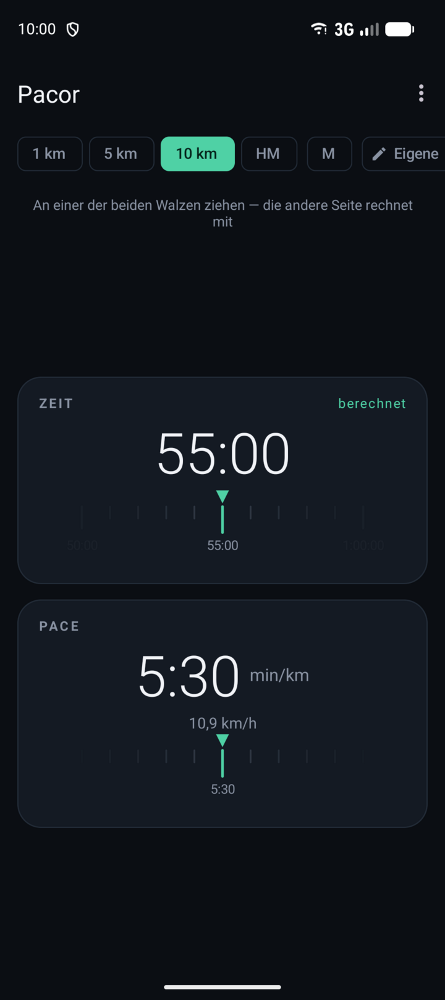
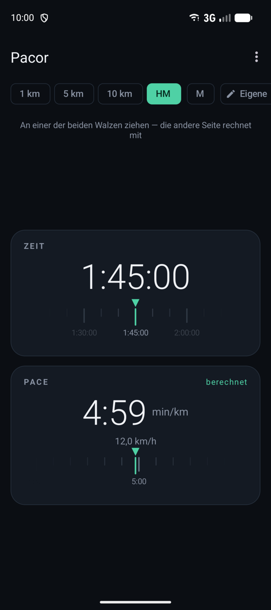

# Pace-Rechner als App

**Pacor** rechnet für Läuferinnen und Läufer zwischen Zielzeit und Pace um: Wie schnell muss ich pro
Kilometer laufen, um den Halbmarathon unter 1:45 zu schaffen? Und welche Zeit kommt auf 10 km heraus,
wenn ich meine gewohnte Pace halte? Statt Zahlen einzutippen, zieht man an einer Walze.

## So funktioniert's

Oben die **Strecke** antippen: 1 km, 5 km, 10 km, Halbmarathon (HM), Marathon (M) oder eine eigene
Länge. Darunter liegen zwei Walzen, eine für die **Zeit** und eine für die **Pace** in Minuten pro
Kilometer. Wer an einer Walze zieht, gibt diesen Wert vor; die andere rechnet mit und trägt die Marke
„berechnet“. Einen Umschalter für die Rechenrichtung gibt es deshalb nicht.

<table>
<tr>
<td width="50%"></td>
<td width="50%"></td>
</tr>
<tr>
<td><b>Pace vorgeben:</b> 5:30 pro Kilometer ergeben auf 10 km genau 55 Minuten.</td>
<td><b>Zielzeit vorgeben:</b> Für 1:45 im Halbmarathon braucht es eine Pace von 4:59, unter der Pace
steht dieselbe Geschwindigkeit in km/h.</td>
</tr>
</table>

## Kleine Details

- **Rastung:** Die Pace rastet in Fünf-Sekunden-Schritten, die Zeit je nach Strecke passend: in
  Fünf-Minuten-Schritten auf Halbmarathon und Marathon, feiner auf den kurzen Strecken. Die berechnete
  Seite zeigt immer den genauen Wert.
- **Mit Schwung:** Die Walzen rollen nach einem schnellen Wisch weiter, und jede übersprungene Raste
  gibt ein kurzes Vibrieren.
- **Streckenwechsel:** Beim Wechsel der Strecke bleibt die Pace stehen und die Zeit wird neu
  gerechnet, denn die gewohnte Pace auf einer anderen Strecke ist die übliche Frage.
- **Eigene Strecke:** Der Chip mit dem Stift nimmt 0,1 bis 1000 km entgegen und merkt sich die
  Länge.
- **Ohne alles:** Kein Konto, kein Internet, keine Berechtigungen.

## Ausprobieren

Auf einem Android-Gerät (ab Version 8) die APK-Datei vom
[neuesten Release](https://github.com/hansmaulwurf23/pacor/releases/latest) herunterladen und öffnen.
Android fragt einmal, ob Apps aus dieser Quelle installiert werden dürfen, und warnt eventuell, weil
die App nicht aus dem Play Store kommt; beides lässt sich bestätigen. Für iPhones gibt es die App
nicht.
